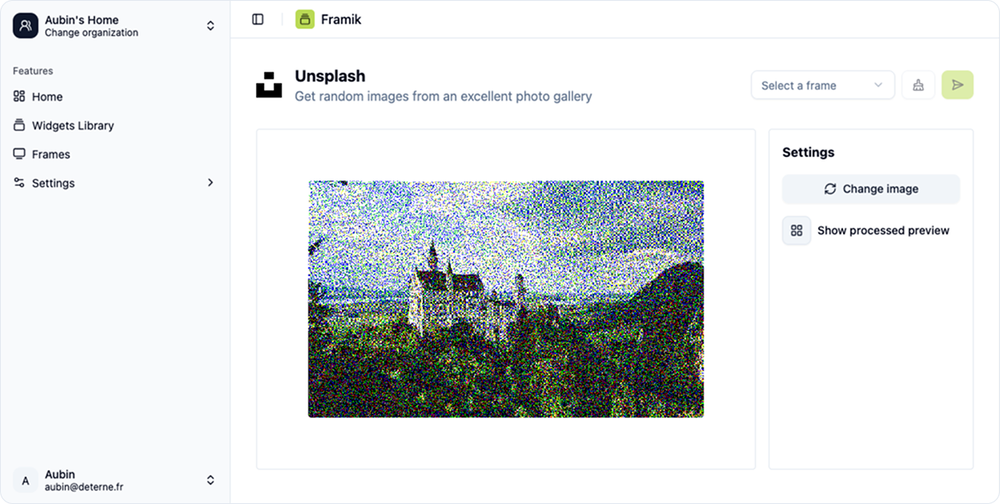

# Framik
> Use an epaper screen as a beautiful frame. Show photos, widgets (calendar, weather, ...)



## Requirements

**Main server machine**

- bun `curl -fsSL https://bun.sh/install | bash`

> Useful alias
> ```sh
> alias framik_stop='pid=$(lsof -ti tcp:4173); [ "$pid" ] && kill -9 "$pid" || echo "Nothing to kill on port 4173"'
> alias framik_start="cd $HOME/framik/apps/web && nohup bun start > "logs/log_$(date +%Y%m%d_%H%M%S).log" 2>&1 &"
> alias framik_build="cd $HOME/framik && bun i --ignore-scripts --filter ./apps/web && bunx turbo build --filter@framik/web --force"
> ```

**Or run the web app with Docker** (linux/arm64 for a Raspberry Pi Zero 2 W with the 64-bit OS, ~180 MB, built by CI on every push to `main`)

```sh
docker run -d --name framik -p 3000:3000 -v framik-data:/data \
  -e PUBLIC_DOMAIN=https://frame.example.com \
  -e BETTER_AUTH_SECRET=<long random string> \
  ghcr.io/aubind97/framik-web
```

- `PUBLIC_DOMAIN` is the URL you open the app with. `ORIGIN` and `BETTER_AUTH_URL` default to it.
- The SQLite database lives in `/data/framik.db`; migrations run at every start.
- Moving an existing `db:push` database into the volume: mark the first migration as applied once, otherwise it tries to recreate the tables:
  `sqlite3 framik.db "CREATE TABLE IF NOT EXISTS __drizzle_migrations (id INTEGER PRIMARY KEY, hash text NOT NULL, created_at numeric); INSERT INTO __drizzle_migrations (hash, created_at) VALUES ('762e0754f0cfb1e0b6383716abd2d3492b42f0a7a2c862419e1b6d561cc4dd29', 1793987449469);"`
- Schema change: `cd apps/web && bunx drizzle-kit generate`, then commit the new file in `apps/web/drizzle`.
- Build locally (any architecture): `docker build -f apps/web/Dockerfile -t framik-web .`
- Only native runtime packages (`@libsql/client`, `sharp` via `@framik/shared`) belong in `apps/web` `dependencies`; everything else goes in `devDependencies` so adapter-node bundles it into the build.

**Daemon machine** (Raspberry Pi, 64-bit Pi OS Bookworm)

- SPI enabled: `sudo raspi-config nonint do_spi 0`
- Nothing else: the daemon is a single static Go binary, built on your machine.

**Deploy the daemon** (needs [Go](https://go.dev/dl/) on your machine)

```sh
# On your machine
cd apps/daemon && bun run build
scp dist/framik-daemon framik-daemon.service framik-captive.conf pi@<frame>:

# On the Pi
sudo install -m755 framik-daemon /usr/local/bin/
sudo cp framik-daemon.service /etc/systemd/system/
sudo cp framik-captive.conf /etc/NetworkManager/dnsmasq-shared.d/
sudo systemctl daemon-reload && sudo systemctl enable --now framik-daemon
journalctl -u framik-daemon -f
```

Update: rebuild, `scp` the binary, `sudo install …` again, then `sudo systemctl restart framik-daemon`.
The current image lives in `/var/lib/framik/current.png`.

**Wi-Fi setup**: after 3 minutes without network the frame starts a `Framik-XXXX` hotspot and shows a QR code to join it (a small banner over the photo if there is one). Joining opens a page at `http://10.42.0.1` to pick the Wi-Fi network. Every 10 minutes it also retries saved networks.

## Setup project
```bash
# Install dependencies
bun i
# Run database migration
cd apps/web && bun db:push
# Start the dev server (the daemon needs Go)
bun dev
```

## Useful tools
- API call can be done using [Yaak](https://yaak.app/) by loading the yaak folder as a workspace
